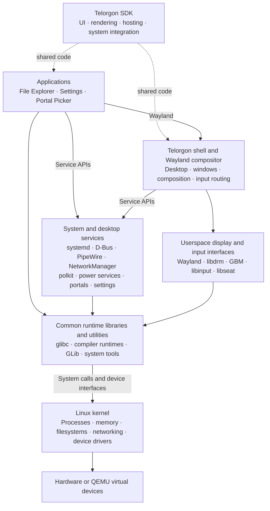
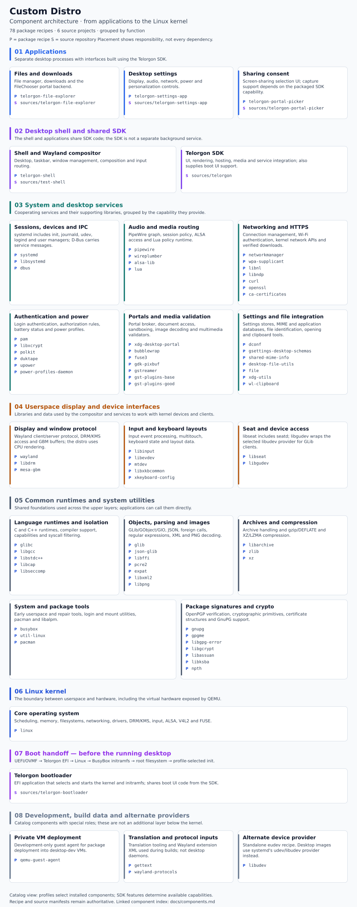

# System architecture

The default product uses the Telorgon bootloader, framework and applications.
The distro owns package recipes, Python coordination, image profiles and guest
system policy. [Source modules](sources.md) identifies the component repositories.

## Runtime layers

Linux supplies scheduling, memory, filesystems, networking and device drivers.
The userspace above it supplies services, a graphical environment and applications.
The desktop combines standard Linux services with the project's own Telorgon
framework, shell and applications.

Solid arrows show major runtime relationships; dotted arrows show shared SDK
code. This is a structural overview, not a complete dependency graph or a rule
that every operation passes through every layer. Applications and services also
use kernel facilities directly.

| Part | Responsibility |
| --- | --- |
| Linux | Owns hardware drivers and the core process, memory, storage and network mechanisms |
| System foundation | glibc provides the C runtime; systemd starts services; udev discovers devices; logind manages sessions; D-Bus carries service messages |
| Desktop services | Manage audio, network connections, power, authorization, portals and shared settings through service APIs |
| Telorgon SDK | Shared Rust code for UI, rendering, application hosting, compositor support and system integration; also provides boot UI support |
| Telorgon shell | Uses the SDK to implement the desktop and Wayland compositor, including window management and input routing |
| Applications | Separate programs using the SDK for their interfaces, Wayland for windows and service APIs for system controls |

The SDK is used by both the shell and applications; it is not a separate
background process between them. The compositor implementation belongs to the
SDK, while the shell supplies the desktop UI and behavior. For
example, a network control in Settings uses NetworkManager's service API;
NetworkManager configures networking through Linux's kernel interfaces.

## Complete component map

The [component architecture](components.md) expands this overview into every
declared package recipe and every registered component repository, categorized
by function. It includes a full-size SVG and a linked text index for libraries,
services, tools and data. Boot, development and alternate-provider components
have separate bands so their roles remain clear.

Profiles select which catalog components enter an image. The map's coverage is
checked against the package and source manifests; versions, source pins and
dependency declarations remain authoritative there.

## Source bootstrap

The bootstrap builds an x86_64 GNU/Linux cross toolchain from the archives in
`bootstrap/sources.lock.toml`. It produces Binutils, Linux API headers, glibc
and separate first/second compiler passes for `x86_64-custom-linux-gnu`.
The second pass supplies C/C++ and the target libgcc/libstdc++ runtimes.
Private Gawk, Flex, libelf, gperf and Meson provide build generators.

Host compilers, Python, headers and generator libraries are declared seeds.
Their filesystem is not a target root. Bootstrap tools stay out of OS packages;
the glibc/libgcc/libstdc++ recipes export only their intended target payloads.
Rust uses the pinned host toolchain with the source-built target SDK.

Stage receipts bind source pins, scripts, predecessor artifacts, native inputs,
file hashes, modes and symlinks. `python3 build.py bootstrap --check` validates
that closure without rebuilding or adopting changed outputs. libc and C++ probes
execute through the target loader with audited target libraries. This establishes
the recorded checks, rather than a self-hosted toolchain or reproducible release.

## Boot and image composition

The boot path is **OVMF → Telorgon EFI → Linux EFI-stub kernel → initramfs →
ext4 root → profile-selected init**. The loader build snapshots framework and
bootloader inputs, retains Cargo locks and builds a fresh EFI artifact.
Its generated configuration selects this distro's own kernel and initramfs.

The image builder creates GPT, a FAT32 EFI partition and an ext4 root in ordinary
files. `fakeroot` records numeric ownership through filesystem generation;
image creation does not mount physical disks, use host loop devices or modify
host firmware. The initramfs uses source-built BusyBox and guest devtmpfs.

| Profile | Runtime policy |
| --- | --- |
| `console` | Minimal BusyBox console and persistent-root boot check |
| `systemd` | systemd/PAM/logind services and normal-user session checks |
| `desktop-use` | Normal Telorgon desktop with private saved VM state |
| `desktop-dev` | Normal desktop plus the private QEMU Guest Agent deployment channel |
| `desktop` | Disposable desktop qualification units and real window/input probe |

Normal desktop use autostarts the local `custom` user through PAM/logind.
Ordinary systemd/desktop passwords remain locked. The console profile exposes
an unattended root console. Password qualification uses a separate private
fixture; interactive account enrollment is a release requirement.

## Desktop services

| Area | Source-built runtime and policy |
| --- | --- |
| Service/session management | systemd, journald, udev, PAM, logind and user manager; separate public libsystemd package |
| Input/display | Wayland, libinput, libxkbcommon, DRM/KMS and seatd/libseat |
| Rendering | Telorgon CPU renderer and DRM dumb buffers; Mesa package supplies GBM, without Vulkan/OpenGL drivers |
| IPC | System and user D-Bus; D-Bus socket activation uses libsystemd |
| Audio/video | PipeWire, its PulseAudio protocol server, WirePlumber, ALSA and V4L2 plugins |
| Network | NetworkManager, libnl/libndp, OpenSSL and WPA supplicant; QEMU supplies user-mode virtual networking |
| Authorization/power | polkit, UPower and power-profiles-daemon |
| Portals | xdg-desktop-portal, document/permission services, File Explorer FileChooser backend and packaged picker |
| Settings | dconf and GSettings schemas plus Telorgon's desktop settings services |
| File integration | libmagic/file, MIME database and desktop entry tools with ALPM cache hooks |

The full systemd profile supplies udev; it conflicts with the standalone eudev
provider. The planner selects one provider. The libseat build uses seatd and its
seat-group socket; using logind for sessions does not add a libseat logind backend.

The desktop session starts its user bus, PipeWire and WirePlumber, then the shell
and graphical-session target before portal activation. Read the actual Wayland
socket from `/run/user/1000/telorgon-wayland-socket`; do not assume `wayland-0`.
Guest policy and units live in `system/desktop/`, `system/desktop-use/` and
`system/systemd/`.

Capture configuration follows the selected framework's declared
`package.metadata.telorgon.software-screencast` capability. Without software
capture support, the CPU profile disables the ScreenCast endpoint; when support
is declared, the package retains consent-based capture. The actual package
records this in `/usr/share/custom-distro/capabilities/telorgon-shell.json`.
FileChooser uses the real File Explorer backend. Installing the picker or broker
does not establish screen-sharing support. A GUI polkit authentication agent,
physical hardware support and enterprise wireless/certificate workflows need
their own implementation and qualification; keep the existing authorization
policy intact.

The media recipes include ALSA and camera plugins; a VM must also expose working
devices and host endpoints. [Build and run](build.md#audio-and-camera) covers the
launcher controls. A built plugin does not establish playback/capture success.

## Native generators and caches

Each package compiles against a private ALPM dependency sysroot. Generator
executables stay in private native prefixes or run through the explicit target
loader on the matching x86_64 host. GNU gettext performs translation merges;
Wayland scanners generate protocol bindings; GLib generates schemas/modules.
The builder records their inputs and rejects unintended host library paths.

ALPM hooks refresh MIME, desktop entry, GIO and schema caches during guest
transactions. Initial assembly suppresses target hooks on the host and prepares
the required combined caches explicitly. No guest service starts on the host.

## Artifact inventory

| Location under `out/` | Contents |
| --- | --- |
| `sources/downloads/` | Verified upstream archives |
| `bootstrap/` | Cross-toolchain, generators, sysroot, logs and receipts |
| `native-toolkit/` | Private host assembly pacman/libalpm tools |
| `work/`, `packages/`, `state/packages/` | Recipe work, immutable archives and current artifact receipts |
| `sdk/` | Composed target SDK and its manifest |
| `apps/`, `loader/` | Frozen source inputs, Cargo caches, artifacts and provenance |
| `state/apps-development/` | Content-specific deployment package receipts |
| `state/run/` | Validated local build-stage reuse receipts |
| `images/objects/` | Content-addressed disk images; aliases identify current candidates |
| `vms/<name>/` | Private saved disk, firmware variables, logs, sockets and deployment receipt |
| `qualification/`, `verification/` | API probes, actual VM results, screenshots and timing evidence |

An image report identifies its base artifacts. A saved development VM can contain
newer pacman-installed apps, so retain its deployment receipt too. Compilation,
host-kernel API probes, guest boot and GUI interaction are distinct evidence.
